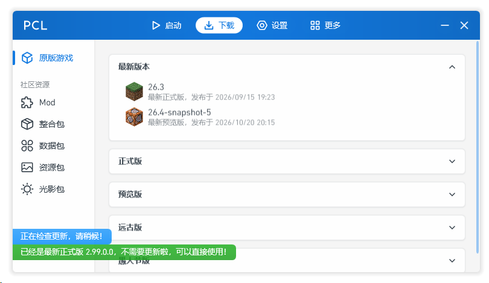

# PCL Download Enable

这是一个 PCL / PCL-CE 的补丁启动器。它为原程序生成同目录的 `<原文件名>.Patch.exe`，原文件保持不变。

| 程序 | 已验证版本 | 补丁行为 |
| --- | --- | --- |
| [PCL](https://github.com/Meloong-Git/PCL) | 2.99.0.0 | 将 `RestrictMcDownload` 改为 `False`，恢复下载页和整合包安装入口 |
| [PCL-CE](https://github.com/PCL-Community/PCL-CE) | 2.15.1.0 | 使 `RestrictedFeaturePolicy.Check` 直接返回 `true` |

程序识别、版本区间和 IL 匹配规则位于 [`patch-profiles.json`](./patch-profiles.json)。配置随 exe 一起嵌入；适配新版本后需重新编译。

https://github.com/Meloong-Git/PCL/discussions/9512
https://github.com/PCL-Community/PCL-CE/discussions/3670



## 使用

1. 将 `PCL-Download-Enable.exe` 复制到 PCL 或 PCL-CE 所在目录。
2. 双击 `PCL-Download-Enable.exe`。

如果同目录同时存在两个目标，请将目标 exe 拖到 `PCL-Download-Enable.exe` 上，或在命令行中指定：

```powershell
PCL-Download-Enable.exe "D:\PCL\Plain Craft Launcher 2.exe"
PCL-Download-Enable.exe --target "D:\PCL-CE\PCL2_CE_Release_x64.exe"
```

启动器以目标所在目录作为工作目录启动补丁副本。补丁副本会保留，之后可以直接双击它继续使用。PCL 需要 [.NET Framework 4.8](https://shimo.im/docs/qKPttVvXKqPD8YDC#:~:text=%E4%B8%8B%E8%BD%BD%E5%B9%B6%E5%AE%89%E8%A3%85%20.NET%20Framework%204.8) 运行环境，PCL-CE 需要 [.NET 10 Desktop Runtime](https://github.com/PCL-Community/PCL-CE#-%E6%94%AF%E6%8C%81%E5%B9%B3%E5%8F%B0) 运行环境。

执行过程会输出带时间戳的控制台日志。只有启动器发生异常时，才会把本次完整日志和异常堆栈写入启动器所在目录的 `PCL-Download-Enable-*.log`；若该目录不可写，则写入系统临时目录。错误窗口会显示日志路径，正常执行不生成日志文件。

更新目标程序后，可先用 `--patch-only --target <exe路径>` 验证。配置中的上界 `99.99.99.99` 允许新版本尝试现有规则，但不保证兼容；IL 结构变化时补丁会失败并提示前往 [GitHub 项目主页](https://github.com/cyb233/PCL-Download-Enable)检查更新或反馈。适配新版本时，在 `patch-profiles.json` 的对应程序下调整版本区间及匹配行为，再重新编译启动器。

## 构建

### 开发环境

- .NET Framework 4.8
  > [这与 PCL2 需求一致](https://shimo.im/docs/qKPttVvXKqPD8YDC#:~:text=%E4%B8%8B%E8%BD%BD%E5%B9%B6%E5%AE%89%E8%A3%85%20.NET%20Framework%204.8)

```powershell
dotnet build PclDownloadEnable.csproj -c Release
```

本地构建的窗口标题使用 `dev`；可通过 `-p:ReleaseTag=v0.0.5` 指定版本标识。GitHub Release 构建会自动写入发布 tag。

构建会生成单个 .NET Framework 4.8 单文件：`PCL-Download-Enable.exe`。`Mono.Cecil` 已在 Release 构建时合并进 exe，运行时只依赖系统已安装的 .NET Framework 4.8。
